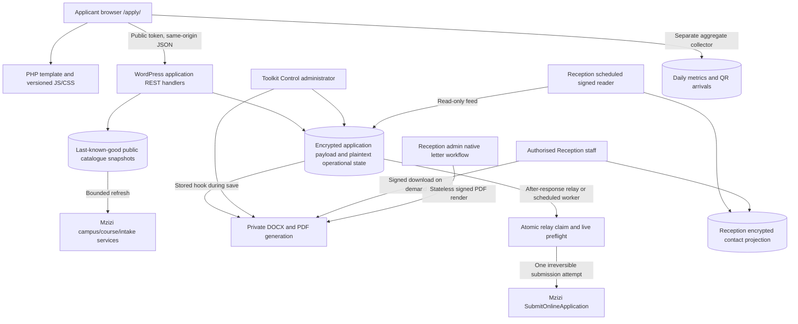
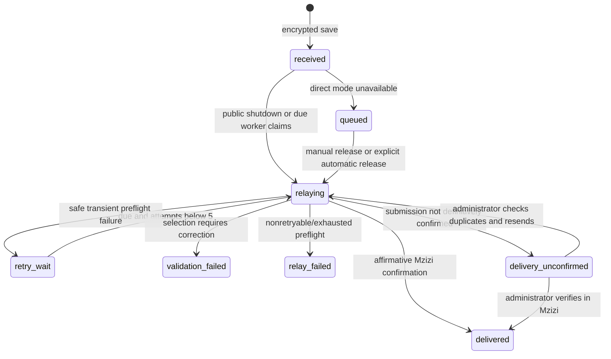

# Website application form — complete technical analysis

Prepared by **Thomas Kamau** · 28 October 2026<br>
Scope: the website `/apply/` journey and every first-party subsystem it directly uses, triggers, exposes to staff or shares with another system.

This is an implementation reference, not a proposed redesign. It covers the browser, WordPress, database, encryption, Mzizi, workers, administrators, calling letters, Reception, metrics, configuration, deployment and failure boundaries. The [source reference](APPLICATION-FORM-SOURCE-REFERENCE-2026-10-28.md) supplies file digests, function locations, hook registrations and configuration names. Follow that index when a later edit moves a line.

## 1. Evidence, versions and limits

The reviewed WordPress checkout is `75c37e9`, whose latest runtime source release is `2026.10.27.1` (runtime commit `c648685`). The Reception checkout reviewed is `885335e`. This analysis changes documentation only. It does not deploy a fix, change settings, query private applicant records, submit an application, replay a Mzizi request or issue a production letter.

| Evidence | What it establishes | What it does not establish |
| --- | --- | --- |
| Current first-party PHP/JavaScript, templates, styles, migrations and tests | Exact source behaviour and relationships described below | Every current database setting, cache layer or plugin behaviour |
| [17 October relay release record](../MZIZI-RELAY.md) | Demo-first relay/cache/worker deployment; runtime hashes and schedules checked then | That every historic 409 failed before Mzizi saved data; current backlog totals |
| [26 October admin and sync release record](../TOOLKIT-ADMIN-RECEPTION-SYNC-2026-10-26.md) | Matching demo/production runtime, mirror schema, first sync and scheduling verified then | A fresh authenticated staff browser acceptance today |
| [26 October calling-letter release record](../RECEPTION-CALLING-LETTERS-2026-10-26.md) | Shared rendering/download integration verified; native demo issuance exercised, production read-only acceptance | Production test issuance, inbox delivery or offline website-letter caching |
| 27 October SEO/public-page verification in WORKLOG | `/apply/` remained a working public surface with current release/canonical checks | A new submission/relay transaction today |
| Isolated checks rerun for this analysis | Actual current validation, phone, signed export, PDF gateway, QR and relay/cache logic pass the listed fixtures | Exhaustive browser, hosting, vendor or penetration-test coverage |

Operational flags and keyring migration must be checked privately before changing them. This report describes their code semantics; it does not expose values or claim a fresh live configuration audit. Historic counts, such as the 28 production applications mirrored on 26 October, are dated evidence rather than current totals. Approved public downloads and the private operational letter template are runtime inputs; project reports and developer documentation are not deployment inputs.

## 2. System shape and ownership

The form is a custom WordPress Eduma child-theme feature. It is server-rendered PHP plus vanilla JavaScript, using WordPress REST endpoints and custom MySQL tables. The Mzizi adapter is procedural PHP around WordPress HTTP functions and JSON `.asmx` methods. Reception is a separate Laravel application. There is no dedicated application microservice, browser-to-Mzizi submission, message broker, React application or generic contact-form plugin in this first-party path.



WordPress owns the website application, delivery history, review state and generated website letters. Mzizi owns its upstream admissions record; Toolkit's local reference is not an upstream admission ID. Reception owns a read-only staff projection and its own, separate native applicant/letter records. The marketing catalogue owns advertised course information and prices; Mzizi owns selectable admissions IDs and live intake availability. These catalogues are not automatically the same dataset.

`functions.php` loads `site-metrics.php`, `application-adapter.php`, `calling-letter-pdf.php`, `calling-letters.php`, `reception-integration.php`, `reception-application-sync.php` and `reception-calling-letters.php`. The adapter in turn loads the phone class, relay queue and catalogue cache. Site metrics loads the shared Toolkit admin/support surfaces. Other theme modules loaded alongside these, such as graduation and editorial stories, share the page shell but do not participate in saving or relaying an application.

## 3. Entry routes, WordPress page selection and shared page assets

`functions.php` registers `/apply/` as an alias for the existing WordPress page at `our-ventures/toolkit-courses-apply-today`. The `init` rewrite configuration looks up that page and targets its numeric page ID. A route-version option prevents flushing rewrite rules on every request. The redesign template map selects `template-parts/pages/apply.php` for the page slug `toolkit-courses-apply-today`. Legacy application paths, including the old `/new/…` path, redirect to `/apply/`; custom redirect handling prevents WordPress canonical redirects from fighting the alias.

The redesign switch is `TOOLKIT_REDESIGN_ENABLED`, otherwise the `toolkit_redesign_enabled` option. Its default is true for the known demo/local hosts and false elsewhere; a configured value overrides the default. Switching the redesign off changes page selection/assets. It does **not** unregister application REST routes, which are loaded globally by the theme. It is therefore not an intake shutdown control.

| Asset/dependency | Role |
| --- | --- |
| Parent Eduma `style.css`, child page header/footer | Shared document shell, navigation and base styles |
| `brand-tokens.css` | Brand colours, typography and shared design tokens |
| `page-redesign.css` | Application grid, panels, progress, guide, form fields, errors, confirmation and responsive layout |
| `page-redesign.js` | Shared custom-page interactions; contains an old course selector listener described below |
| `assets/css/phone-input.css` | Country selector/number/preview layout |
| `assets/js/phone-countries.js` → `phone-input.js` → `application-form.js` | Metadata, international formatting and the six-step form; explicit enqueue dependencies |
| Cloudflare Turnstile `api.js` | Enqueued only when direct submission is fully enabled |
| `assets/js/toolkit-metrics.js` | Separate first-party aggregate interaction/QR metrics |

`toolkit_asset_version($path)` joins the theme release and local file modification time. A changed `toolkit_theme_release()` flushes the WordPress object cache and asks LiteSpeed to purge page/CSS/JS caches once per environment. The release also appears in custom-surface response headers. This is cache invalidation/versioning, not proof that every downstream cache has refreshed.

`wp_localize_script` exposes `window.toolkitApplication`: four REST URLs, the public form token, the conditional public Turnstile site key and Admissions contact strings. Neither the Turnstile secret, encryption key nor Reception signing secret belongs in this object. The PHP template separately outputs the Turnstile widget when direct submission is enabled.

The page title, description, canonical, social image, Yoast WebPage/Breadcrumb integration and sitemap aliases live in `functions.php`/`inc/seo-discovery.php`. Demo canonical/noindex handling is environment-specific. These influence discovery, not submission authentication. Public theme headers set nosniff, SAMEORIGIN, strict-origin-when-cross-origin referrer policy, restricted browser capabilities and HSTS on HTTPS. This header block does not establish a complete Content Security Policy; web-server/plugin headers require separate deployed inspection. The page calls `get_header()` and `get_footer()`; there is no child `header.php` in this checkout, so the installed parent supplies the header. The child footer is tracked. Installed WordPress core, Eduma and plugins are excluded from this Git repository; their full internals and current settings are not represented by this first-party inventory.

## 4. Browser workflow, fields and request construction

The form has six fieldsets and no native POST fallback. JavaScript intercepts submission; the form uses `novalidate` and explicitly calls browser validity APIs. Disabled JavaScript or an early script failure can prevent completion. Fields stay in DOM memory while moving between steps; no applicant draft is saved in browser storage by the form code.

| Step | Fields and browser constraints | Server significance |
| --- | --- | --- |
| 1. Personal | `first_name`*, `middle_name`, `surname`*, `gender`* F/M/I, `nationality` default Kenya/max 80 | Scalar required checks for first/surname/gender; exact gender enum; nationality is descriptive text |
| 2. Contact | `email`* email/max 160; `county`*; primary and secondary/guardian phone*, both max 40; required country selectors, default KE | Qualified email check, 47-county allowlist, both phones normalized/validated; country selections do not represent nationality |
| 3. Course | `school_id`*, `course_id`*, `intake_id`*; mode blank/Physical/Online; sponsorship blank/Self-Sponsored/Sponsored; referral source | IDs and display labels saved; live semantic selection validation occurs during relay |
| 4. Background | Mean grade/max 20, high school/max 160, qualifications/max 1200 | Optional sanitized strings; corresponding browser limits are not all repeated server-side |
| 5. Documents | Instructions only | No file input, multipart upload, attachment storage or document transmission to Mzizi |
| 6. Review | Selected summary, consent* value 1, privacy link, conditional Turnstile | Consent required; timestamp generated on the server; Turnstile checked only in direct mode |

An invisible `website` field is a honeypot. Browser-generated fields may also contain `cf-turnstile-response`. The submit handler uses `FormData`, converts entries into a JSON object and adds `school_name`, `course_name`, `intake_name` from the selected option text. Those strings come from the client, even though the normal browser initially obtained the choices from the server.

Initial options are requested once on load. Changing campus resets course/intake, then loads courses. Changing course resets and loads intakes. Options are inserted using DOM `textContent`; the review builder HTML-escapes all dynamic values before assigning `innerHTML`. The guide shows selected course text and generic admissions guidance, not a synchronized price, prerequisite or verified course duration. Intake-loaded text is not the programme duration.

The review displays names, email, both phones, campus/course/intake, county, mode, sponsorship and qualifications. It omits gender, nationality, referral source, mean grade and high school even though they are submitted. Forward navigation validates prior steps, backward navigation permits corrections, the active step has `aria-current`, field errors use live-region help, and invalid fields receive focus. Progress is `floor((step + 1) / 6 * 100)`, starting at 16% before any data is entered; it measures navigation, not validated completeness.

Every form API call uses `fetch` with `credentials: 'same-origin'`, the `X-Toolkit-Form-Token` header and JSON for POST. There is deliberately no `X-WP-Nonce`: the source comments describe the prior cached, user-bound nonce causing WordPress cookie-check failures. These public operations are not privileged account actions. The client reads JSON and reduces non-2xx responses to their message; it does not retain error code/data in a typed error object. There is no custom fetch timeout, cancellation, automatic submission retry or offline outbox.

On successful 2xx save, the button is re-enabled after completion, the form resets, step 1 reappears, Turnstile resets, and the confirmation scrolls into view. The reference message fades after 12 seconds plus 0.5 seconds. There is no applicant-facing status lookup, login, emailed receipt guarantee or public letter download in this implementation. On failure the fields remain; Turnstile is not explicitly reset by the catch handler.

Two less obvious shared-state details matter:

- `?course=…` is sanitized into `data-initial-course`, but the current application JavaScript does not read it. Marketing links do not establish working course preselection merely by supplying that parameter.
- `page-redesign.js` also listens to `#toolkit-course-choice` and writes the raw option value plus a description from an old hardcoded title map. Current option values are numeric Mzizi IDs. The dedicated form script also updates the same guide with the actual label. Current normal enqueue/listener order lets the later dedicated handler overwrite the old output synchronously, but duplicate ownership is fragile and a source of temporary/undefined content if script execution/order changes. This is a source-level interaction, not a newly observed live failure.

Course/intake requests have no response-sequence guard. A fast selection change can let a slower earlier response overwrite a later choice list. Server relay validation remains necessary even when all displayed dropdowns look correct.

## 5. Public REST contract and trust boundary

Base namespace: `/wp-json/toolkit/v1`.

| Method and resource | Request | Successful body | Protection |
| --- | --- | --- | --- |
| GET `/application/options` | No applicant body | `schools`, `counties`, `sources`, each `id`/`label` lists | Public guard, 30 calls per route/IP bucket/15min |
| POST `/application/courses` | `school_id` | `courses` list | Guard plus exact visible campus ID allowlist |
| POST `/application/intakes` | `course_id` | `intakes` list and source indicator | Guard plus known course ID in cached visible-campus catalogues |
| POST `/application/submit` | Form JSON described above | 201 with `code`, `message`, `reference`, `delivery` | Guard limit 5, honeypot, field validation, conditional Turnstile, storage duplicate lock |

The route permission callbacks are public; the callbacks themselves call `toolkit_application_request_guard`. This distinction is intentional. No public endpoint reads encrypted applications, exports contacts, edits review state or downloads a letter.

The form token is HMAC-SHA256 of `toolkit_application_form|<12-hour Unix window>` using `wp_salt('nonce')`. Current and previous windows are accepted with constant-time comparisons. A page token therefore lasts between roughly 12 and 24 hours depending on when it was rendered. It is site-wide, public and cache-compatible, not user authentication, OTP, proof of human identity or a private API key. A cache retaining page HTML beyond the accepted windows can keep giving out stale tokens.

The guard rejects a supplied Origin that differs from `home_url()` after trailing-slash normalization; absent Origin is accepted. Requests need a valid public token regardless. Rate keys combine route basename with a salted hash of `REMOTE_ADDR`. Counters are WordPress transients, incremented with get/set and a fresh 15-minute TTL; this is a sliding, non-atomic limit. Shared NAT users can share a bucket; reverse-proxy address handling depends on the hosting layer. No custom untrusted forwarded-IP header is consumed here.

`nocache_headers()` plus `X-LiteSpeed-Cache-Control: no-cache` are important: the source records a previous LiteSpeed cache hit bypassing the guard entirely. Correct cache behaviour is part of the authentication/rate-limit boundary, not only performance tuning. The signed Reception feed has its own stricter no-store headers and does not use this public token.

## 6. Validation and international phone handling

`toolkit_application_submit` validates in this order: guard; honeypot; conditional Turnstile; required scalar fields; normalized email; gender; consent; mode/sponsorship; county; primary/secondary phone; encrypted storage. Required fields are first name, surname, email, both phone numbers, school/course/intake IDs, county, gender and consent.

Email is lowercased/trimmed, capped at 160 and checked with WordPress `is_email` plus the qualified-domain expression; a complete alphabetic TLD is required. `audit@com` is rejected. Consent must string-cast to `1`. Gender must be exactly F/M/I. County is uppercased and compared with the local list of 47 Kenyan counties. There is no server rule for a foreign county even when an international phone is accepted. Mode and sponsorship use exact allowlists including blank.

Phones use shared metadata generated from Google libphonenumber's `PhoneNumberMetadata.xml`, retrieved 5 October 2026, source digest `2fa0728c949aa59ee4d95bd68ff6398988b3ef4069d70965cc1ae080b7236e5c`. PHP and JavaScript hold matching data for 245 countries/regions, flags, calling codes, trunk prefixes, examples and permitted national-number patterns. This is a generated snapshot, not a live library service or automatic metadata updater. Its Apache-2.0 provenance/license notice must survive packaging.

The formatter accepts a string up to 40 characters containing only digits, `+`, spaces, parentheses and hyphens. It tries the national number, removal of a trunk prefix, removal of the selected calling code, and calling-code-plus-trunk removal where the national regex permits it. The final international digits must fit 15 digits and the country-specific pattern. Examples for KE all produce `+254712345678`: `0712345678`, `712345678`, `254712345678`, `2540712345678`, `+254712345678`, `+254 712 345 678`. Italian leading zero and shared calling codes require country metadata rather than unconditional zero removal.

The browser detects a valid typed international number, selects a matching country/flag, previews the normalized value and commits formatting on blur/submit. A deliberate selector change is validated against that country. Server-side `countryFor()` first tries preferred KE, then compatible calling-code candidates ordered by code length and main-region preference. If the request omits a country it can infer one; if a country is explicitly supplied it validates that choice and rejects a mismatch. Arrays, invalid regions, alphabetic input and excessive length fail safely. Shared codes and local-number ambiguity mean this is format detection, not reliable physical location. Valid landline patterns are included; despite the function name `normalize_mobile`, the implementation is not mobile-only. No number lookup, reachability, subscriber ownership, email ownership or SMS OTP verification takes place.

Browser maxlength attributes do not replace server limits. Server validation does not consistently cap names, nationality, education text, submitted display labels or total JSON bytes. IDs are required scalars but later reduced to digits rather than checked against the catalogue before saving. A tampered scalar can therefore yield an empty/altered stored ID and a locally accepted record that fails later. Display labels can also be supplied independently of IDs. This is a confirmed validation/trust gap; a malicious production request was not sent to demonstrate it.

Turnstile verification posts secret, response and remote IP to the fixed Cloudflare siteverify endpoint with an 8-second timeout. The callback checks `success`; it does not additionally validate returned hostname/action. Captcha is required only when direct submission is enabled. In local queued mode, field checks, public token, honeypot and rate limit remain, but captcha is not required. No email/SMS provider currently supplies the separately requested applicant OTP feature.

## 7. What is saved, where it is saved and encryption

The sanitized encrypted payload has 24 keys: `first_name`, `middle_name`, `surname`, `gender`, `nationality`, `email`, `county`, `primary_phone`, `secondary_phone`, `school_id`, `school_name`, `course_id`, `course_name`, `intake_id`, `intake_name`, `study_mode`, `sponsorship_type`, `referral_source`, `mean_grade`, `high_school`, `qualifications`, `consent_at`, `source_page`.

`consent_at` is a server UTC ISO timestamp, not a client claim. `source_page` is the canonical local `/apply/` URL, not the full incoming URL/referrer. The stored payload excludes country selector fields, captcha response, honeypot, caller IP, full user agent, UTM tags, documents, identity numbers and payment details. Infrastructure access logs may independently contain IP/URL data; payload minimization does not erase those server logs.

### Application table: `{prefix}toolkit_applications`, schema version 1.3.0

| Columns | Type/purpose |
| --- | --- |
| `id`, `reference` | Unsigned bigint primary key; unique varchar(32) reference |
| `status`, `workflow_status` | varchar(32) delivery state; varchar(24) staff review state, default `new` |
| `payload` | LONGTEXT encrypted JSON envelope |
| `created_at`, `updated_at`, `relayed_at` | UTC DATETIME; relayed nullable |
| `relay_attempts`, `next_relay_at` | Unsigned smallint counter; nullable due date |
| `relay_phase`, `relay_lease`, `relay_lease_until` | varchar(24) phase; char(36) worker token; nullable lease expiry |
| `relay_http_status` | Nullable unsigned smallint upstream HTTP status |
| `last_error`, `mzizi_message` | Nullable plaintext TEXT; new relay paths use redacted summaries/constant confirmation |
| `fingerprint` | Nullable char(64) keyed duplicate fingerprint |

Indexes cover reference uniqueness, status, due date, lease expiry, review state, created date and fingerprint. The fingerprint index itself is not unique. Schema installation uses WordPress `dbDelta` on theme activation/init priority 3 and only marks the version after the expected table/relay columns exist.

The events table is `{application_table}_events`: bigint id, application_id, varchar(32) event_type, nullable actor_id, nullable TEXT message, UTC created_at; indexes application/event/date. No foreign key or automatic cascading cleanup is defined for these WordPress tables. Events are ordinary database rows, not a tamper-proof audit ledger. State updates and their event insertions are not one database transaction.

AES-256-GCM encrypts JSON with a fresh 12-byte IV and 16-byte authentication tag using OpenSSL. Envelope version 1 stores base64 `iv`, `tag`, `data`; version 2 also records `kid`. No additional authenticated data binds the ciphertext to the application ID/reference; confidentiality/integrity of the payload does not encrypt or authenticate the separately stored operational metadata.

Dedicated keyring configuration uses `TOOLKIT_APPLICATION_ENCRYPTION_KEYS` (key IDs → base64-encoded random 32-byte keys) and `TOOLKIT_APPLICATION_ENCRYPTION_CURRENT_KEY_ID`; a single-key compatibility constant also exists. A valid current dedicated key produces v2. Without one, the compatibility path derives a key from the current WordPress auth salt and `|toolkit-applications`, producing v1. V1 decryption tries configured legacy candidates/current fallback; v2 selects the named key. Dedicated-key support in source is not proof every deployed record has migrated.

[The keyring runbook](../APPLICATION-ENCRYPTION-KEYRING.md) documents `wp toolkit applications-migrate-encryption --dry-run`, then the non-dry command after a private backup. The CLI command requires a dedicated key, verifies round trips and updates only if the original ciphertext is unchanged, reporting counts without keys or applicant records. Retain legacy keys until failures/conflicts are resolved. Reusing invalid/mutating key IDs, dropping an old key or rotating auth salts before migration can make old data unreadable. WordPress's auth/nonce salts, application keyring, Reception APP_KEY and shared integration secret have different purposes and require distinct recovery handling.

## 8. Duplicate detection, reference allocation and save atomicity

The application fingerprint is HMAC-SHA256 of lowercased email, normalized primary-phone digits and digit-only course ID separated by `|`, using the WordPress nonce salt. Before checking/inserting, a MySQL `GET_LOCK(...,0)` serializes that fingerprint within the application table. Busy lock acquisition returns 503 `application_busy`; a finally block releases the lock. The latest matching saved record within 30 days returns local 409 `duplicate_application`, its existing reference and a user-facing message. It does not call Mzizi.

This is duplicate submission protection, not returning-visitor identity. It ignores intake, campus and name; two intended intakes with the same contact/course can collide, while a changed contact/course bypasses it. Salt rotation changes future fingerprints. A precise matching caller can learn the existing reference from the duplicate response; the public token is not a secret authorization boundary. References should never be treated as a password for any later feature.

Reference format is `TTI-YYYYMMDD-XXXXXX`, using UTC date and six uppercase random alphanumeric characters. The unique database index prevents collisions; insertion tries three references. The loop does not distinguish a collision from other DB insert failures. After insert, a `stored` event and `toolkit_application_stored` hook fire synchronously. That hook generates a calling letter before the REST callback returns. The main row is already durable; letter/event exceptions or interruptions cannot be rolled back as a single all-or-nothing application transaction.

## 9. Save response, immediate relay and state machines

When direct submission is not fully enabled, the callback changes the saved row to `queued`, records an event and returns 201 `code: queued`, `delivery: queued`. When direct submission is enabled, it leaves/marks it received, stores a watchdog due date five minutes ahead, registers an after-response relay and returns 201 `code: received`, `delivery: relaying`. Both messages say the application was submitted to Toolkit and Admissions will follow up. They do not promise an upstream admission or issued student number.

The shutdown callback calls `fastcgi_finish_request()` or `litespeed_finish_request()` if available before relaying. Without either, the network work still runs in PHP shutdown and the client may wait. The same PHP worker remains occupied; this is not a separate queue daemon. The durable due date allows a scheduled worker to claim a saved application if shutdown never starts/completes.



The separate review workflow is `new` → `in_review` → `resolved`, adjustable by an administrator independently of delivery. A resolved review is not delivered; delivered does not automatically resolve review. `relay_phase` is `preflight`, `submitting` or `complete`; a lease token and expiry identify the worker allowed to finish. Historic display labels such as `handoff_required` remain for compatibility, not as a newly emitted successful-save state.

## 10. Mzizi sessions, endpoints and protocol

`toolkit_mzizi_application_url()` points to the organisation's fixed public `OnlineApplicationForm.aspx` page with its form selector. The backend GETs it with an 8-second timeout, up to two redirects, and `ToolkitAfrica-Admissions/1.0` user agent. HTTP200 plus session cookies are required. Subsequent `.asmx` calls reuse those cookies server-side so the chosen school is in the same session. These are JSON POSTs, not SOAP envelopes/WSDL-generated clients. No student password is entered by this integration.

`toolkit_mzizi_post()` builds a fixed `https://toolkit.mzizi.co.ke/PortalWebServices/` destination from internal service names. POST redirects are disabled, request Content-Type is JSON, an empty payload encodes as `{}` via an object cast, default timeout is 8 seconds (clamped 3–30), and response size is capped1MiB. The final submit uses 25 seconds. WordPress safe HTTP functions retain normal TLS validation.

| `.asmx` method | Body | Role/result used |
| --- | --- | --- |
| `StudentInfo.asmx/GetSchools` | `{}` | Campus IDs and `Name` labels |
| `StudentInfo.asmx/GetCustomerSources` | `{}` | Referral sources; the public selected value is the source **name** |
| `StudentInfo.asmx/SetApplicationSchoolIDParam` | `SchoolID` | Set campus session context; requires Success |
| `StudentInfo.asmx/GetApplicationCoursesNoAlumni` | `{}` | Courses for selected campus; public labels use Description |
| `OrganizationProcesses.asmx/GetCourseIntakeMonths` | `CourseID` | Course intake IDs and LevelName |
| `OrganizationProcesses.asmx/GetCurrentYearIntakeMonths` | `{}` | Fallback only if course-specific intake list has no usable entries |
| `StudentInfo.asmx/SubmitOnlineApplication` | The18 fields below | Irreversible admissions submission |

Responses decode to associative arrays. A narrow compatibility repair handles an array followed by literal `{"d":null}`, observed for GetSchools. This is not a general decoder for every ASP.NET `d` wrapper. Non-2xx or unusable JSON becomes an error carrying a sanitized service name and upstream HTTP status, without copying raw bodies. Transport failures expose a generic 503 service-unavailable message. A slow dependency chain can consume several request timeouts; no single end-to-end wall-clock budget is imposed across the full relay.

## 11. Exact upstream field mapping

Preflight revalidates stored mode/sponsorship, opens a fresh session, sets campus, obtains live courses/intakes/sources, finds exact saved IDs and verifies referral source name. Only then does it build:

| Toolkit source | Mzizi key | Conversion/meaning |
| --- | --- | --- |
| `first_name` | `FirstName` | Sanitized text |
| `middle_name` | `SecondName` | Blank allowed |
| `surname` | `LastName` | Sanitized text |
| `nationality` | `Nationality` | Saved descriptive value; default Kenya if absent |
| `county` | `County` | Saved county label/code |
| `email` | `Email` | Sanitized address |
| `primary_phone` | `MobileNo` | International `+`/digits |
| `secondary_phone` | `altPhoneno` | International `+`/digits; exact lowercase casing matters |
| `mean_grade` | `MeanGrade` | Optional |
| `qualifications` | `Qualifications` | Sanitized multiline text |
| `school_id` | `SchoolID` | Digit-only ID |
| `high_school` | `HighSchoolAttended` | Optional |
| Matched live intake `LevelName` | `IntakeMonth` | **Label, not `intake_id`** |
| `study_mode` | `ModeOfStudy` | Blank, Physical or Online |
| `sponsorship_type` | `SponsorshipType` | Blank, Self-Sponsored or Sponsored |
| `referral_source` | `Channel` | **Validated source name, not numeric source ID** |
| Matched live course `Name`, otherwise Description | `ClassApplied` | **Course text, not `course_id`** |
| `gender` | `Gender` | Uppercase F/M/I, including normalization for older records |

The Toolkit reference, row ID, course ID itself, consent timestamp, source URL, phone countries, captcha, staff notes, documents and prices are not in this 18-field upstream payload. There is no payment collection/checkout transaction here. Live preflight also writes authoritative course/intake labels back into the encrypted payload; campus display name is not reconciled by this relay call.

Illustrative request only — fictional values and IDs, never a production test:

```json
{
  "FirstName":"Synthetic", "SecondName":"", "LastName":"Example",
  "Nationality":"Kenya", "County":"NAIROBI", "Email":"fixture@example.test",
  "MobileNo":"+254712345678", "altPhoneno":"+254112345678",
  "MeanGrade":"", "Qualifications":"", "SchoolID":"1",
  "HighSchoolAttended":"", "IntakeMonth":"Illustrative intake",
  "ModeOfStudy":"Physical", "SponsorshipType":"Self-Sponsored",
  "Channel":"Website", "ClassApplied":"Illustrative course", "Gender":"F"
}
```

## 12. Relay concurrency, uncertainty, retries and the two 409 errors

A single conditional SQL UPDATE claims an eligible row before any upstream request. It sets `status=relaying`, phase preflight, UUID lease, expiry 15 minutes, increments attempts and clears the due date/old error. Another shutdown/manual/cron worker cannot acquire the same active lease. Public relay may claim a received row with a due date; automatic relay requires attempts below 5 and a due received/retry_wait row. Untouched queued rows participate automatically only with explicit `TOOLKIT_MZIZI_AUTOMATIC_RELEASE_ENABLED === true`. Manual release requires manage_options and duplicate-check attestation; it may retry reviewed terminal/uncertain rows and is not limited by the automatic attempt ceiling.

Immediately before SubmitOnlineApplication, the worker persists phase `submitting` while its lease is still valid. If that write fails, it does not send. If PHP dies after that marker, the outcome must be treated as uncertain even if the network call never began. Once the irreversible POST might have happened, safe automatic replay is impossible without upstream idempotency or a reliable upstream record lookup.

The current success classifier requires a usable array, an acceptable Success field if provided, no rejection wording, and either boolean `Success: true` or a message containing success/successful/successfully. Error/fail/invalid/duplicate/already/unsuccessful/not/never/cannot/unable veto confirmation. It is intentionally stricter than the old nonempty-message check, but still a heuristic. A string/numeric truth value without affirmative wording is not identical to boolean true in the final condition. A vendor response-contract change can therefore change classification.

| Outcome | Local state and treatment |
| --- | --- |
| Confirmed success | `delivered`, phase complete, UTC relayed_at, constant safe confirmation; lease cleared |
| Final POST HTTP409, timeout, malformed body or nonaffirmative response | `delivery_unconfirmed`, no next retry; record HTTP status when available; require Mzizi-side check |
| Safe preflight transport/408/425/429/5xx failure | `retry_wait` if below cap, with bounded delay |
| Invalid live course/intake/source or invalid saved choices | `validation_failed`; requires review |
| Nonretryable/exhausted preflight | `relay_failed`; requires review |
| Failed local completion update after remote call | Do not assume no delivery; stale lease recovery later handles uncertainty |

Automatic preflight backoff is attempt 1:5min,2:15min,3:1h,4:4h; attempt 5 has no further automatic retry. These are delays after failure, not promises of immediate execution. Recovery examines at most five stale rows per run. An expired known preflight lease can return to retry_wait if under cap; an expired submitting/unknown legacy row becomes delivery_unconfirmed. Normal processing then claims at most three due records per run. A missing worker does not silently prove the queue is healthy; heartbeat/due dates must be monitored.

There are two unrelated 409s: public **local duplicate 409** means a matching Toolkit record already exists; **Mzizi409** means the upstream submission returned a conflict/error that does not prove its transaction rolled back. The user-reported generic Mzizi wording did not identify a cause. The17 October fixes corrected verified field-variable/casing, concurrency, confirmation and retry flaws, but did not establish the vendor root cause of every 409. Never blindly replay an uncertain application to investigate.

There is no upstream idempotency key, upstream student/application ID persisted on confirmation, exactly-once delivery guarantee or implemented programmatic Mzizi search/reconciliation API. The local lease prevents competing Toolkit sends, not vendor duplication after a human-authorized resend or independently submitted Mzizi form.

## 13. Course snapshots, outage behaviour and label resolution

Catalogue snapshots are non-autoload WordPress options named `toolkit_mzizi_snapshot_options`, `…courses_<schoolID>`, `…intakes_<courseID>`. Each stores public payload plus updated_at, checked_at, retry_after and a safe last_error code. There is no applicant data in this cache. A still-valid old transient can be migrated into the durable option.

Warm reads return the last good payload even when old and do not synchronously refresh it. Cold misses perform a guarded upstream fetch. Successful empty course/intake lists are permitted where the upstream list is genuinely empty; unreadable nonempty data does not replace a good snapshot. Options require usable campuses. A stale snapshot remains available through an outage; a never-cached campus/course still depends on its first successful fetch.

Refresh validates key syntax, takes a nonblocking MySQL advisory lock and checks the default 6-hour interval (filterable, minimum 1h). A failed refresh preserves payload and sets 30-minute cooldown. Forced refresh bypasses the age interval, not cooldown. Scheduled refresh constructs keys only from known visible campuses/courses, caps enumeration at 500 keys, prioritizes least recently checked and refreshes at most two per run. Arbitrary public parameters cannot freely create options for guessed IDs.

Kakuma is filtered by case-insensitive label substring in both public server options and browser fallback. This is a display/business filter, not a separate authorization system. The local save and live relay campus check do not reuse an explicit visible-campus allowlist; a rule intended to prohibit applications to a hidden campus must be enforced at the submission boundary, not only hidden in a dropdown.

Snapshot source labels use Name for campuses, Description for courses and LevelName for intakes. Referral options deliberately expose the name as ID. The marketing `inc/course-catalog.php`/course templates contain different descriptive/fee data; editing a poster or price does not change Mzizi course IDs/intakes. The current digital-fee discrepancy is separately recorded in the price comparison; this architecture analysis changes no fee.

The hourly `toolkit_application_resolve_course_names` hook scans the latest 100 applications, skips rows with both names present, attempts at most three and records a safe heartbeat. It uses fresh campus/course/intake lookups and updates only course/intake labels, then fires `toolkit_application_names_resolved`. Old unresolved records outside the 100-row window can be starved. Nonempty client-supplied labels are not automatically selected for this resolver. The relay's label-update helper does not itself fire the names-resolved hook, which matters for letters generated earlier.

## 14. Scheduling and runtime execution

The theme adds a five-minute WordPress cron interval, schedules `toolkit_application_process_queue` and an hourly name-resolution event on init, and attaches the catalogue refresher after the queue callback at priority 20. WordPress cron remains dependent on the installation's invocation arrangement.

`scripts/deployment/mzizi-relay-worker.php` is an approved **private CLI runtime worker**, not a public helper. It accepts only named demo/production roots, refuses web execution, disables displayed errors, sets DOING_CRON and bootstraps WordPress. A private per-environment nonblocking `flock` bounds job overlap; database leases remain the per-record protection. Normal mode explicitly processes the queue and refreshes catalogues. It does not explicitly run the hourly label resolver. An `inspect` mode checks relay columns/hook/flags and returns limited metadata; it bootstraps/install-checks storage, so it is not a byte-only filesystem audit.

The17 October release added private five-minute hosting jobs because the existing general WordPress cron jobs ran only every two hours. Demo/production are staggered and were verified then. Worker output includes limited status/heartbeat and generic exception class, not applicant payloads or raw exception strings. Its source location under deployment scripts does not mean the whole scripts directory belongs on the server: only the selected runtime worker does.

Operational timeout policy for deployment reads (the user's maximum four total attempts) is unrelated to the five-attempt admissions preflight policy, five-page Reception sync limit or bounded letter requests. Never use deployment retries to repeat an uncertain Mzizi mutation.

## 15. Toolkit Control: permissions, review, release and export

The Applications, Admissions settings and Calling letters pages require WordPress `manage_options`. This is a capability check, conventionally held by administrators, not a hardcoded role-name check. Granting that capability to another role also grants these operations. All application `admin_post_*` handlers require the capability and scoped WordPress nonces; there are no anonymous admin mutation hooks.

| Operation | Route/action | Boundary and effect |
| --- | --- | --- |
| Review state | `toolkit_application_workflow` | Authenticated, nonce scoped to record; new/in_review/resolved only |
| Manual release | `toolkit_application_release` | POST, record nonce, `duplicate_checked`; sends through lease-protected relay |
| Confirm upstream delivery | `toolkit_application_confirm_delivery` | POST, nonce, `confirmed_in_mzizi`; conditional local reconciliation, **no resend** |
| Resolve labels | `toolkit_application_resolve_names` | POST/nonce; fresh catalogue lookup, no SubmitOnlineApplication |
| Export CSV | `toolkit_application_export` | Authorized nonce-protected download, status/reference filters, max 5000 rows |
| Admissions settings | `toolkit_application_save_settings` | POST/nonce; relay/security flags, encrypted Turnstile keys, settings audit |

Manual delivery reconciliation does not independently search Mzizi; it records the administrator's attestation. Active/delivered/leased state guards prevent claiming an in-flight record as reconciled. Review changes, relay events and letters all have distinct states; one successful administrative action does not prove the others completed.

Admissions settings encrypt the key option using the same application encryption machinery. Masked unchanged site keys and blank secret fields preserve prior values; clearing requires the explicit clear flow. Saving managed settings makes the database-managed mode authoritative over earlier constant-based settings. Operators must check precedence before changing wp-config and assuming it took effect. Settings audit records action/user/time; it is not email delivery or applicant OTP evidence.

The list decrypts only displayed records; it loads 40 per query, supports a `paged` offset in the source but currently renders no corresponding list pagination controls. Search uses reference rather than encrypted names/email. Global counters distinguish totals/new/delivered/queued/review-needed; heartbeat text reports last worker/name resolution. The detail page escapes rendered fields, shows up to 50 events and offers only the relevant authorized controls. There is no ordinary applicant-detail editing form or WordPress application-delete handler in this module.

CSV uses prepared status/reference filtering, UTF-8 BOM and `fputcsv`, normalizes formula-leading `=`, `+`, `-`, `@`, tab and carriage return with an apostrophe, streams without writing a public file, and counts/skips decrypt failures. The result is plaintext personal data in an authorized download; encryption at rest does not persist after export. Export auditing uses a global event/application ID0 with counts/admin/filter. A free-text reference filter could itself contain personal text entered by an operator; do not assume every event message is guaranteed PII-free.

Toolkit admin styling and navigation live in `inc/toolkit-admin.php` plus its CSS/JS; support-hub links provide operational entry points. They do not replace the permission checks in each handler. The Application QR preview/counts are another view of the metrics table, not a separate admissions database.

## 16. Website calling letters: generation, template and private files

The stored and names-resolved hooks call `toolkit_calling_letter_generate_safely`. Generation is synchronous in the save/resolution request, before the applicant's save response. A catch wrapper records failures so ordinary template errors do not intentionally prevent saving; it is not protection against every fatal termination/resource exhaustion. An available course name is required; otherwise the row waits for resolution. Letter generation alone does not establish final admission, Mzizi delivery or academic eligibility.

The `{prefix}toolkit_calling_letters` table, version 1.2, contains id, unique application_id, status, file_path, pdf_path, email_status, sms_status, print_status, last_error, generated_at and updated_at. It has no application foreign key/cascading cleanup. Channels default disabled. The upgrade deliberately changed old apparent sent states to unverified rather than retroactively claiming delivery.

Private storage is created outside the WordPress root under `toolkit-private-storage/calling-letters`. The approved template is `_template.docx`; generated documents are separated by the website's home-host subdirectory, with sanitized `<applicationID>-<reference>.docx/.pdf` filenames. The host-derived separation matters on shared demo/production hosting. Additional deny/index files are defense in depth, not a substitute for being outside a public root. Generated website letters are **plaintext private files**; the application payload's AES envelope does not encrypt them.

DOCX generation uses DOM/XML plus ZipArchive or WordPress PclZip fallback, modifying the approved template package rather than accepting a client document. It replaces date/name/phone/course placeholders and specific paragraph positions, removes selected blank/content paragraphs, expands the contact header and adjusts signature spacing. The positional paragraph assumptions are brittle if someone edits/reorders the template. Template replacement therefore needs a checked fixture/render, not just a new filename.

PDF is generated separately in pure PHP: `Toolkit_Pdf_Page` draws one A4 page (595.28 ×841.89 points), measures regular/bold font widths, encodes WinAnsi text, wraps styled runs, escapes PDF strings and writes compressed objects/xref/trailer. It does not launch LibreOffice, shell commands or a remote conversion service. Logos/stamp/signature come from fixed DOCX media entries, including `word/media/image5.png` for the logo. PNG decoding supports 8-bit noninterlaced grayscale/RGB and alpha variants, inflates IDAT, reconstructs row filters and produces colour/alpha streams. Arbitrary applicant PNG uploads never enter this decoder.

Decoded assets use private serialized caches keyed by entry/content digest and in-process memoization. Cached reads use `unserialize(..., ['allowed_classes'=>false])`; the 26 October hardening prevents object instantiation. Cache hashing is for content identity, not a replacement for storage permissions. Unicode beyond the renderer's font/encoding/transliteration support needs representative name tests; it is not a full Unicode shaping engine.

PDF failure can leave a generated DOCX with no PDF path. One website letter row and predictable paths are updated on regeneration; this is not immutable multi-version website history. A unique database row does not serialize concurrent writes to the same generated filenames; no per-application generation lock was found in this path.

**Intake wording needs explicit attention.** Website PDF intake text comes from `toolkit_calling_letter_intake`, otherwise the source fallback is **August/September 2026 Intake**. Website generation does not pass the selected application's intake into the PDF renderer. The DOCX retains other approved template wording rather than applying the native-render intake option. Current live option/template contents were not reread for this analysis, so this establishes a stale-default/inconsistency risk, not a claim every live letter has the wrong intake.

Initial `course_name` can come from submitted display text before live preflight. The stored hook may generate a letter with that label. The later relay can correct the saved labels without regenerating the existing letter because its helper does not fire the resolution hook. Treat current automatically produced letters as needing this trust/consistency review; sanitized text alone is not proof a course selection is authoritative.

Admin downloads require capability and record nonce. The private-file resolver rejects null bytes, backslashes, parent-path segments, a symlink file, unexpected basename, unreadable/nonfiles and realpaths outside the exact permitted current/legacy directory. Downloads use fixed MIME type, attachment disposition, no-cache, nosniff and content length. No user-supplied destination/path or public applicant download route is accepted. Regenerate/send/settings each have protected admin actions.

Email uses `wp_mail`, PDF preferred and DOCX fallback, only when enabled. Mail API acceptance is stored as **submitted**, not delivered; legacy sent/unverified states suppress routine duplicate sends. Microsoft365 sender policy/SMTP readiness still governs actual inbox delivery. SMS and print enabled paths mark queued; no SMS provider/printer worker is implemented here. These flags must not be reported as completed message delivery. Some letter failure paths call `error_log` with exception messages, which can contain private paths; that is a narrower redaction guarantee than the sanitized Mzizi worker logs.

## 17. Reception website-application mirror

The website exposes GET `/wp-json/toolkit/v1/reception/applications`. Sharing defaults off unless enabled by `TOOLKIT_RECEPTION_APPLICATION_SYNC_ENABLED` or its option, and requires an integration secret at least 32 characters. The secret is the existing private Reception API secret, not the public form token or either application's encryption key.

Only `after` and `limit` query keys are allowed: digit-only cursor up to 15 characters, limit 1–50. Headers carry timestamp,32-hex random nonce and 64-hex HMAC-SHA256. The canonical signed message is:

```text
timestamp + "\n" + nonce + "\napplications-read-v1\n" + integer_after + "\n" + integer_limit
```

Timestamp tolerance is 300 seconds. Constant-time signature verification and atomic `add_option` replay keys reject duplicate nonces; nonce records live 10 minutes and expired cleanup is bounded at 100 per request. Response headers are `no-store, private, max-age=0` and noindex/nofollow/noarchive. Application rows are ordered by ID after cursor; the server fetches limit+1 to calculate has_more. Decryption/malformed-field failure fails the whole page closed instead of leaking ciphertext or skipping an applicant silently.

Response version 1 exports exactly 14 fields per application: id, reference, assembled name, email, primary phone, course, intake, campus, delivery_status, delivery_label, review_status, submitted_at, updated_at, delivered_at. Dates are explicit UTC. Secondary phone, qualifications, consent, raw payload, upstream messages and errors are excluded. Metadata includes source demo/production, next_cursor and has_more. Name parts are capped 120 each, email 254, phone 64, course 240 and intake/campus 160 before export. The form's looser input limits can therefore create a saved row that blocks a later feed page; a fail-closed export is not a repair/quarantine mechanism.

Laravel `WebsiteApplicationSync::source()` permits only the exact HTTPS main/demo website hosts. APP_URL determines the default; `WEBSITE_APPLICATIONS_SOURCE_URL` may select a permitted source. Reception signs GETs with `RECEPTION_WEBSITE_SHARED_SECRET`, connect timeout 5, total timeout 15, no redirects and no automatic HTTP retry. It checks response size 262144 bytes after receipt, validates version/source/types/lengths/row keys, requires strictly increasing distinct IDs and validates cursor consistency. The response body cap in this sync path is not a transport-level early-abort guard.

Every five minutes `reception:sync-website-applications` takes a 150-second shared lock and reads at most five pages of 50 rows (250/run). Schedule overlap control adds another guard. Per-page transactions upsert rows and cursor progress together. A generation UUID labels a complete scan; once complete, cursor resets to 0 so later cycles refresh changed delivery/review labels on existing rows. At larger volumes, an old row refresh can take multiple scheduled runs, not exactly five minutes.

The `website_applications` table has source_site/source_id unique, reference, generation/source_missing, contact text columns, course/intake/campus, delivery/review labels, source dates, sync dates and local timestamps. Eloquent encrypts name/email/phone with Laravel APP_KEY; descriptive course/intake/status fields are plaintext. References are searchable, encrypted contacts are not used for unrestricted SQL search. A complete successful scan marks unseen rows source_missing but keeps their copies. Failures keep prior data and record only safe code/time with 30-minute cooldown. The ordinary native-applicant retention command does not delete this mirror; its lifecycle needs a separate policy.

Staff routes require login, an allowed active role and the required password change. Receptionist, admissions, manager and administrator can view the labelled **Website application · Read-only sync** register/details and request existing website letters. There are no mirror create/edit/delete/release-to-Mzizi/write-back routes. This read-only guarantee is in service/controller/route design, not a database user with SELECT-only privileges; the sync service must write its own projection. Detail access is audited with IDs and HMAC-hashed IP, not applicant contact fields.

## 18. Reception letters and the shared renderer boundary

Website letters are fetched on demand, not copied with every application sync. GET `/reception/applications/<id>/calling-letter` returns an existing website PDF; POST `/reception/calling-letters/render` renders a **Reception-native** letter without creating a website application, changing its status or calling Mzizi. Both require sharing enabled plus `TOOLKIT_RECEPTION_CALLING_LETTERS_ENABLED`/the corresponding option and a valid shared secret. Reception also requires `CALLING_LETTERS_ENABLED`.

The letter signature binds a different purpose, method, resource and exact raw-body SHA256:

```text
timestamp + "\n" + nonce + "\ncalling-letters-v1\n" + METHOD + "\n" + resource + "\n" + sha256(raw_body)
```

GET resource is `application:<id>`; POST resource is `render-native`. There are no query parameters; body cap 8192 bytes; timestamp tolerance 300 seconds; separate replay-key namespace. An existing-letter response contains version/source/reference/application_id/SHA256/base64 PDF. A render response substitutes template_revision for application_id. Signature purposes separate these protocols from the application feed and legacy visitor relay, although all trust the same shared secret.

Native render accepts exactly reference, name, phone, course and intake. Reference follows the APP- format; field lengths are 64/120/16/120/120, phone is E.164-shaped, control characters and angle brackets are rejected, and per-word width must fit the layout. It uses a confined private temporary PDF, checks the intended directory even if tempnam falls back elsewhere, sets 0600, verifies the template/renderer revision did not change mid-render and deletes temporary output in finally. Explicit intake and strict single-page layout avoid silently using the website default for native letters.

The Laravel gateway restricts hosts/environment, refuses redirects, checks connect/total timeouts, bounds JSON transfer (~1.5MB) and decoded PDF1MiB, verifies exact envelope keys, reference/application identity, strict base64, `%PDF-`/EOF and SHA256. These checks are integrity/format safeguards; they are not a full PDF malware scanner. PDFs originate from the approved renderer, not arbitrary uploads. Website errors become a generic unavailable message; there is no fallback host or automatic retry. Previously issued native Reception PDFs stay available during website outage; new native renders and website PDF downloads depend on website availability. No offline website-letter cache exists.

Native applicant issuance is administrator-only in route and controller, uses CSRF/throttles, a 90-second per-applicant lock and daily keyed input fingerprint, requires replacement confirmation and limits history to 10. After rendering, a DB row lock rechecks applicant name/phone; the encrypted base64 PDF, digest, issuer, version and template revision are stored with an issue audit in one transaction. Contact changes abort issuance rather than silently using stale details. Native calling letters have a cascading applicant foreign key and encrypted hidden model field; they differ from WordPress's plaintext version-overwritten files.

The dedicated Calling letters sidebar workspace also supports admin-only standalone Details → Review → Issue, private search, PDF/history and controlled cleanup. Its manual-letter table is independent of website applications. This is an adjacent consumer of the common renderer, not a path for staff to edit mirrored website applicants. Workspace rules are documented in the Reception repository `docs/CALLING-LETTER-WORKSPACE.md`; its internals do not extend the public website form contract.

## 19. Adjacent visitor integration: separate data and transaction

`inc/reception-integration.php` defines a different `/toolkit/v1/reception/submit` operation for website visitor registration, not student admission. It shares the public form token and integration secret infrastructure but stores no visitor record in WordPress. Name/phone/optional email/organisation/purpose/consent are validated and posted to Reception `/api/website/visits` using a timestamp/nonce/raw-body signature and 12-second timeout. It expects 201/reference from Reception.

This older public guard requires an Origin or Referer host/scheme and has a five/hour IP bucket, unlike the application guard's missing-Origin allowance and five/15min. Reception's inbound route has signature middleware and throttle. The visitor service does not mirror the 24-field application payload, generate a website admissions reference or call Mzizi. A returning visitor's check-in identity/auto-checkout rules belong to Reception's native visit workflow; the website application fingerprint is not that identity tracker.

## 20. QR, analytics, privacy and attribution

The printable application PNG/SVG targets `https://toolkitafrica.ac.ke/apply/?utm_source=application_qr&utm_medium=qr&utm_campaign=admissions`. It is a direct tagged form link, not an application record or a Reception entry code. The browser metrics module records `interaction:application_qr_scan` once per session using a distinct sessionStorage key, so an earlier untagged page visit does not suppress a tagged arrival. Toolkit Control previews/downloads the code and shows 30-day/all-time counts; Site analytics offers selected windows. [QR semantics and release evidence](../APPLICATION-QR.md) remain applicable.

The separate public POST `/toolkit/v1/metrics` accepts only known event names, sanitized path/label and bounded numeric value, with Origin/Referer checks and 60/minute hashed-IP transient rate limiting. `{prefix}toolkit_metrics_daily` version 2.0 stores date/path/event/count/total/max/updated with a unique daily event key and aggregate SQL upsert. It does not store the application contact JSON. Query strings are stripped from metric paths; source labels are constrained rather than storing arbitrary referrers.

The browser honors DNT1, sends beacon/fetch keepalive, counts page views once per path/session, scroll buckets, performance, engagement, outbound clicks, link-based application starts and known source labels. It does not emit a verified successful application-save/delivery event from the submission handler. QR counts are anonymous tagged openings, not verified camera scans, unique people or completed applications. Shared links, script blocking, session-storage failures and anonymous forged events limit accuracy. The generic page-view sessionStorage access lacks the QR branch's exception handling; metrics failure does not intentionally stop the separate form IIFE.

Global WordPress plugins, Site Kit or external analytics may add scripts/processing independently of these modules. A source trace of the theme does not establish their current live consent, analytics or mail settings. The privacy link points to `/privacy-policy/`; its database-managed wording was not audited here. A future legal/privacy assessment must reconcile actual live policy/retention/provider settings, rather than treating this code report as policy approval.

## 21. Configuration, framework dependencies and deployment boundary

| Control | Authority and effect |
| --- | --- |
| `TOOLKIT_REDESIGN_ENABLED` / option | Custom page/asset presentation; not REST shutdown |
| `TOOLKIT_MZIZI_SUBMISSION_ENABLED` | Relay flag unless dashboard-managed mode takes precedence |
| Turnstile enabled/site/secret constants or encrypted managed settings | With relay flag, makes public direct mode active |
| `TOOLKIT_MZIZI_AUTOMATIC_RELEASE_ENABLED` | Explicit release of untouched local queued rows |
| Application current-key ID/keyring/single-key compatibility constant | Payload and encrypted security-option encryption/decryption |
| Catalogue refresh interval filter | Age target, minimum 1h; default 6h |
| `toolkit_calling_letter_intake` | Global website PDF intake wording, not selected intake |
| Letter email/SMS/print options | Channel state controls; do not provision providers |
| Reception API URL/secret | Fixed visitor destination and shared signed interoperation |
| Application-sync and letter-sharing flags | Independent private feed/render enablement gates |
| Reception APP_URL, WEBSITE_APPLICATIONS_SOURCE_URL, RECEPTION_WEBSITE_SHARED_SECRET, CALLING_LETTERS_ENABLED, APP_KEY | Environment mapping, gateway trust, feature gate and Laravel encryption |

The source reference enumerates actual option/constant names without values. WordPress contributes REST dispatch/error encoding, sanitization/escaping, $wpdb/prepared queries, DB schema helper, HTTP/TLS/cookie processing, options/transients, user capabilities, admin nonces, hooks, cron, wp_mail and PclZip fallback. Parent Eduma and plugins share page generation; they are not the application's admissions service. PHP needs OpenSSL/AES-GCM and random bytes for payloads; DOM/XML and ZIP or PclZip plus zlib/string/PDF support for letters; mbstring for the signed feed's multibyte length checks; database support and writable private storage. Reception additionally depends on its existing Laravel framework/database/cache/crypto/HTTP/scheduler stack. No new Composer/npm service is required by this analysis.

The deployed PHP runtime is not the same evidence as the local PHP8.4.23 used for tests. The26 October assessment recorded WordPress production EA-PHP8.3.36 and demo EA-PHP8.4.27, with fileinfo missing in the relevant earlier platform checks; CLI build evidence is not proof of web-worker restart state. The one-run deployment exception for those urgent letter features is closed. Do not infer future Composer checks can ignore fileinfo, or use this analysis to authorize a PHP upgrade. No runtime interpreter/module/package change is made here.

Deployment uses repository scripts/cPanel file operations with fresh baselines and exact anchored patches to preserve live drift. The17 October relay set comprised four theme PHP modules plus the private runtime worker; later admin/letter releases added their own tightly allowlisted files/migration/views. Demo checks precede production promotion. Release scripts/journals test hashes, dependencies, environment, interruption and cleanup; they are local operational tooling, not automatically public assets.

Only selected runtime PHP/JS/CSS/images, required migrations/views and explicitly approved private runtime inputs belong on the host. Exclude this report, README/AGENTS, tests, fixtures, source maps, local databases, snapshots, backups, archives and deployer scripts other than the approved private worker. Keep required licenses and approved public downloads. Never replace private wp-config/env/keys from a repository bundle. A rollback of code does not roll back a Mzizi submission or safely remove an additive database migration; preserve private evidence and reconcile uncertain records first.

## 22. Security and failure findings, with their practical consequence

These are findings of this analysis, not fixes deployed by it. Priority reflects the next review order, not a measured penetration-test severity score.

| ID | Evidence-backed finding | Consequence / bounded follow-up |
| --- | --- | --- |
| A01 | Stored display labels/IDs are not semantically verified before local save and letter generation | Validate canonical choices before issuing authoritative-looking letters; keep outage acceptance separate from approval |
| A02 | Server input lengths/body size are weaker than Reception export/render limits | Align limits across boundaries; isolate/review a malformed saved row so it cannot block an entire sync page |
| A03 | Website intake comes from global option/old fallback; relay label update does not trigger letter refresh | Bind generated artifacts to verified course/intake and a generation revision; review current template/option privately |
| A04 | No vendor idempotency/authoritative record query; success classification is wording-based | Obtain Mzizi's stable response/duplicate contract; keep uncertain records out of automatic replay |
| A05 | Public queued mode disables captcha along with direct mode; public token is reusable | Decouple intake-abuse control from relay enablement; review atomic limiting without claiming token is authentication |
| A06 | Unbounded retention and no WordPress application/letter cleanup cascade; Reception mirror retained separately | Set an approved lifecycle covering DB, events, files, exports, mirror and backups |
| A07 | Synchronous letter generation precedes 201; no shared transaction for row/events/hook | Bound expensive work and record repairable failures; do not imply all side effects succeeded when only row exists |
| A08 | Website regeneration overwrites files without a per-application render lock | Review atomic file replacement/versioning and concurrent admin/hooks |
| A09 | Course/intake fetches race; query preselection is unused; legacy guide listener competes | Add narrowly scoped browser checks before any UX correction |
| A10 | Save reference disappears after 12 sec; no applicant receipt/status; review omits some fields | Retain a useful confirmation and complete review; require explicit ownership/privacy design before public status features |
| A11 | Resolver scans only latest 100, at most 3; admin list lacks pagination controls | Make backlog visibility/resolution bounded but traversable |
| A12 | Letter exception logs can contain paths; operator filter text can enter export audit | Apply safe codes/redaction consistently and document access to private logs |
| A13 | Shared integration secret grants several purpose-separated protocols | Rotate/store with both systems, minimize exposure and consider distinct future credentials; never expose it client-side |
| A14 | Mail accepted is not delivered; SMS/print workers and applicant OTP are absent | Keep delivery labels honest; provider work remains a dependency |
| A15 | Cache/proxy behaviour is part of guard correctness; private sync size cap is post-read | Reverify normal private response caching at release; bound sync transport as well as decoded data |

Existing protections remain material: encrypted payloads/contacts, admin capabilities/nonces, prepared SQL, public/private separation, the fixed Mzizi host and allowlisted Reception source hosts, replay-bound private signatures, no applicant upload path, private realpath-confined downloads, durable save before upstream, conditional leases and stop-on-uncertainty recovery. The older visitor relay uses its separately configured private destination. None proves every plugin, hosting service or upstream system is vulnerability-free. The analysis did not run live attack probes, brute force, uploads or authentication bypass attempts.

## 23. Operator decision guide and recovery

1. **Applicant reports failure/no reference:** inspect Toolkit Control by reference if available; a network/browser failure can follow a successful row insert. Do not ask the applicant to repeatedly resubmit or resend upstream blindly. Authorized staff may use controlled reference/filter tools; do not export the full database for routine triage.
2. **Queued:** check relay/security configuration and whether this is deliberate local-only intake. Enabling relay is not authorization to mass-release old queued records; explicit automatic-release setting exists for that reason.
3. **Retry wait:** verify due date, attempt count, heartbeat and safe preflight error. Waiting for the scheduled preflight retry is different from replaying a submission that may have reached Mzizi.
4. **Delivery unconfirmed/409:** an authorized administrator checks Mzizi for that person/course/intake. If found, use confirm delivery; if definitely absent, review before explicit release. Preserve what established absence and avoid putting contact data into general logs.
5. **Relaying too long:** let lease recovery distinguish preflight from submitting; do not manually clear a lease while a worker may still send. A fifteen-minute expiry is recovery logic, not proof of rollback upstream.
6. **Courses unavailable/stale:** inspect snapshot last success/cooldown and private worker heartbeat. Preserve last-good data; refresh only known catalogue keys. A stale advertised choice is revalidated before upstream submission.
7. **Reception stale:** inspect source/environment/clock/secret availability, cursor/error/cooldown and last successful full cycle. Keep prior copies labelled stale/missing; do not create native applicants to compensate for a mirror error.
8. **Letter unavailable/wrong text:** check private template, verified labels/intake option, generation/PDF status and access controls. Regeneration can replace the website copy. A website outage blocks on-demand retrieval/render, while previously issued native PDFs remain local to Reception.
9. **Encryption failure:** verify key IDs and retained legacy keys privately; use count-only dry-run/recovery runbook. Do not rotate salts/keys as a blind first response or publish ciphertext/keys to debug.

## 24. Verification performed for this analysis

| Check run on current source | Result | Isolation/limit |
| --- | --- | --- |
| `php scripts/tests/system-audit-application.php` | 524 checks passed | Synthetic WordPress/storage boundary; network forbidden |
| `node scripts/tests/international-phone-parity.js` | 759 checks passed |245 metadata examples, country-code/trunk/international round trips; no live phone service |
| `php scripts/tests/reception-application-sync.php` |28 checks passed | Signature/replay/query/privacy/encrypted-payload boundary with synthetic rows |
| `php scripts/tests/reception-calling-letters.php` |47 checks passed | Signed routes, real renderer with generated image fixture, path/privacy/cleanup failures; no live site |
| `node scripts/tests/application-qr-metrics.cjs` |Passed | Tagged arrivals/session dedupe/ordinary traffic exclusion/DNT fixtures |
| `php scripts/tests/mzizi-relay.php <temporary socket>` |73 checks passed | Real disposable MariaDB11.8.8; every upstream HTTP response mocked; zero Mzizi requests |

The first socket-only MariaDB launch was prevented by the filesystem/network sandbox from binding a Unix socket. The same isolated test ran with the necessary execution permission, passed and shut down; its temporary database directory was removed. This was a local harness restriction, not a production DB/application failure. Private test output and source hashes are retained under ignored `reports/application-architecture-2026-10-28/`.

Earlier Reception release totals and real demo/private-kernel acceptance are in the linked release records; they are not silently represented as a fresh full Laravel/browser suite. This session's analysis uses no fresh live mutation or live negative test. Staff acceptance, actual runtime flags/template contents, present mail delivery and the vendor 409 root cause remain separate checks. No runtime file changed, no architecture finding was patched, and no project documentation was sent to a server.

## 25. Reading and change map

For a field addition, trace template → JS validation/review/payload → PHP validation → sanitized 24-key payload → crypto/backward compatibility →18-field vendor mapping if applicable → admin/CSV → optional 14-field mirror → letter tokens/layout → metrics/privacy → tests/migration/deployment. Updating only the visible input misses most of that contract.

For a relay change, review fresh upstream contract, irreversible boundary, leases/recovery, retry eligibility, HTTP classification, duplicate policy, worker scheduling and redacted events. For a phone change, regenerate/synchronize both metadata consumers and rerun PHP/browser parity; never replace country rules with unconditional `+254` concatenation. For a letter change, exercise both website DOCX/PDF and Reception strict native render using approved assets, failure cleanup, no-send behaviour and long/international names. For a private API change, update both repos' signing/validation/environment bounds and test replay/cursor/body limits before demo-first promotion.

The accompanying [source reference](APPLICATION-FORM-SOURCE-REFERENCE-2026-10-28.md) gives the concrete navigation inventory, digests and function/hook/config indexes. Together these documents are the technical handoff; the concise weekly management plan remains a separate deliverable.

## 26. Complete public request/response example

This example is a contract illustration, not an instruction to POST to production. All person/course values are fictional; a caller must obtain current valid choices and public token normally. The browser sends the token as a header, not an encrypted field. The required country selectors and optional empty fields are shown so downstream differences are explicit.

```http
POST /wp-json/toolkit/v1/application/submit
Content-Type: application/json
X-Toolkit-Form-Token: <current public page token>
Origin: https://toolkitafrica.ac.ke
```

```json
{
  "first_name":"Synthetic", "middle_name":"", "surname":"Example",
  "gender":"F", "nationality":"Kenya", "email":"fixture@example.test",
  "county":"NAIROBI", "primary_phone_country":"KE",
  "primary_phone":"0712345678", "secondary_phone_country":"KE",
  "secondary_phone":"0112345678", "school_id":"1",
  "course_id":"1", "intake_id":"1", "study_mode":"Physical",
  "sponsorship_type":"Self-Sponsored", "referral_source":"Website",
  "mean_grade":"", "high_school":"", "qualifications":"",
  "consent":"1", "website":"",
  "school_name":"Illustrative campus", "course_name":"Illustrative course",
  "intake_name":"Illustrative intake",
  "cf-turnstile-response":"<fresh challenge response when direct mode requires it>"
}
```

```json
{
  "code":"received",
  "message":"Application TTI-20261028-ABC123 was submitted successfully. Toolkit Admissions will review it and contact you about the next step.",
  "reference":"TTI-20261028-ABC123",
  "delivery":"relaying"
}
```

The successful HTTP status is 201; queued mode changes code/delivery to queued. The reference is illustrative. A WordPress REST validation failure uses the standard error shape, for example:

```json
{
  "code":"invalid_phone",
  "message":"Enter valid phone numbers for the selected countries. Kenya (+254) is the default.",
  "data":{"status":422}
}
```

The client displays the message but does not preserve this machine-readable code in its Error object. Local duplicate 409 additionally carries an existing reference in data. Private signature replay 409 and Mzizi upstream 409 are different operations again; an HTTP number without endpoint/context is insufficient to diagnose the application.
